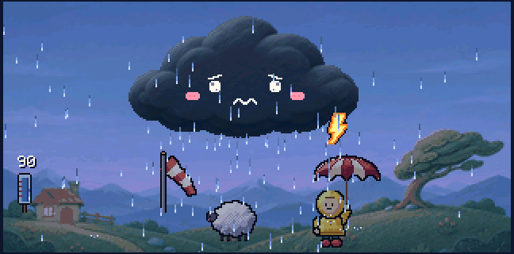

# Storm Cloud



边弹边给吉他加一场雨。雨和风分开调，雷声可以单独关掉。

## 配套音频包

先安装音频包，再安装 App。

- Storm Voice `org.resona.creative.storm-cloud.voice` 1.0.0

## 两个编码器

| 页面／模式 | 上方旋转 | 上方短按 | 上方长按 | 下方旋转 | 下方短按 | 下方长按／按住 |
| --- | --- | --- | --- | --- | --- | --- |
| Storm Cloud | 调雨声 | 雷声开／关 | 无功能 | 调风声 | 空间小／宽／巨大 | 长按重置 |

## 项目详细说明

# Storm Cloud

A Box App where your playing is the weather. Play softly and it drizzles; dig in and the cloud
turns black, the wind gets up and the rain comes down; pick hard and lightning strikes. Stop for
nine seconds and the sun comes back out, with a rainbow.

The sound is the nested pack in `dsp/` (**Storm Voice**), which the App starts and drives itself.

## Controls

| Encoder | Turn | Click | Long press |
| --- | --- | --- | --- |
| SELECTOR (top) | RAIN | THUNDER on / off | |
| CUSTOMIZE (bottom) | WIND | SPACE: small / wide / huge | reset |

Settings are saved. Turning a knob shows what it does for a moment (a shower, a gust), and
switching THUNDER on throws a bolt. Every setting is also on the controller (below), with the
thunder's level, MIX and LEVEL, which the knobs leave at 60 %, 100 % and 0 dB.

## Controller

Play Storm Cloud from the Web or Mobile controller (`controller/`) or any MIDI controller: one CC
per control on channel 1; CC 119 asks the App for every value. The pads change the weather only
while held.

| CC | Control | Values |
| --- | --- | --- |
| 20 | Rain | 0..127 = 0..100 % |
| 21 | Wind | 0..127 = 0..100 % |
| 22 | Thunder | 0 off, 1 on |
| 23 | Thunder level | 0..127 = 0..100 % |
| 24 | Space | 0 small, 1 wide, 2 huge |
| 25 | Mix | 0..127 = 0..100 % |
| 26 | Level | 0..127 = -12..+6 dB |
| 30 | POUR (hold) | RAIN 100 %; 127 press, 0 release |
| 31 | GALE (hold) | WIND 100 % |
| 32 | STORM (hold) | rain, wind and thunder at 100 %, SPACE huge; throws a bolt |
| 33 | SUN (hold) | the dry guitar (MIX 0), a clear sky, the rainbow |

## The scene

| You see | It means |
| --- | --- |
| The cloud's colour and face | how hard you are playing, scaled by RAIN and WIND |
| Rain gauge by the house | RAIN |
| Windsock | WIND |
| The little bolt the cloud holds | THUNDER is on |
| Valley haze | SPACE (small, wide, huge) |
| Lightning, the sheep leaping | a hard pick (at most every 3 s, like the thunder) |
| Umbrella up / inside out | it is raining / it is blowing a gale |
| Puddles | how long it has been raining |
| Rainbow and sunglasses | nine seconds of silence |

The App cannot read the pack's state: everything follows the input meter, the controls and time.
The valley and cloud are generated artwork. The App renders rain, wind, lightning and the cloud’s expressions live.

## Storm Voice (dsp/)

```
guitar -> blown about (tremolo + slow doppler sway, WIND) -+-> dark plate reverb (SPACE, SIZE)
dynamics -> RAIN + WIND + THUNDER                           |
guitar + MIX x (weather + reverb) -> limiter (-1 dBFS)
```

Every layer is scaled by the guitar's own level, so the weather is as loud as you are and fades
out when you stop.

| # | Parameter | Range | What it does |
| --- | --- | --- | --- |
| 0 | RAIN | 0..100 % | droplets (short falling pings at random pitches, the odd fat one) over a soft hiss; density and level follow the dynamics and linger about 1.5 s |
| 1 | WIND | 0..100 % | two resonant bands of noise a fifth apart whose pitch drifts and climbs as you dig in; also the depth of the guitar's tremolo and doppler wobble |
| 2 | THUNDER | 0..100 % | on a hard, sudden pick: a crack that splits two or three times, then a rolling rumble below 120 Hz for 2-4 s; 3 s cooldown; 0 = off |
| 3 | SPACE | 0..100 % | amount of the outdoor reverb (thunder and wind are sent into it too) |
| 4 | SIZE | 0..100 % | its decay, 1.4 .. 8 s |
| 5 | MIX | 0..100 % | all the weather against the guitar alone (0 = the untouched guitar) |
| 6 | LEVEL | -12..+6 dB | output |

## Build

```
resona-lab build dsp            # the pack: host checks
resona-lab pack build dsp       # the installable pack
python3 tools/encode_weather.py  # Pillow 12.1+
resona-lab app build .          # the App
resona-lab app preview . --out preview.png --event selector:turn:+5 --advance-ms 700
```

## 开机动画

新版云层有毛毡质感，雨点带有长短不同的拖尾，闪电会分叉。开机时先出现云、雨和闪电，再渐入山谷。

## Changes

- 1.1.5 — Brighter rainy valley and clearer haze differences across SPACE settings.
- 1.1.4 — Brighter valley and consistent mountain silhouettes across SPACE settings.
- 1.1.3 — Textured valley and cloud, layered rain, branching lightning and a matching startup sequence.
